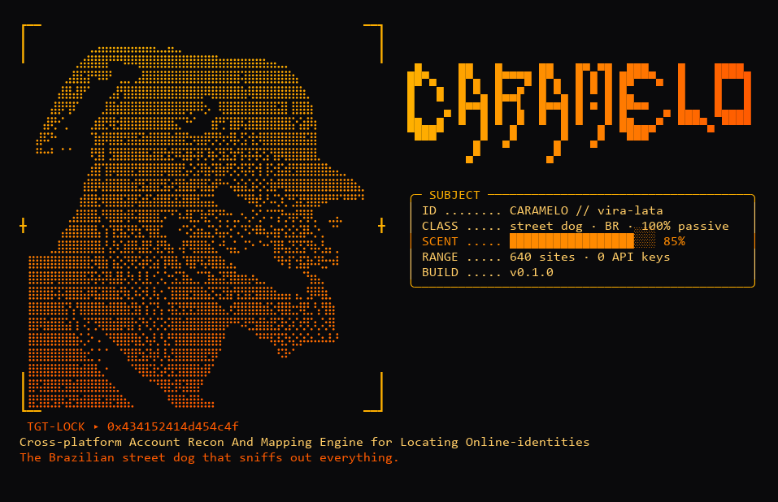

# 🐕 CARAMELO

<p align="center">
  
</p>

**C**ross-platform **A**ccount **R**econ **A**nd **M**apping **E**ngine for **L**ocating **O**nline-identities

*The Brazilian street dog that sniffs out everything.*

Caramelo is a passive username OSINT tool. Give it a username (or a real name) and it checks 5,767 validated sites for **public profiles**, then builds a dossier with each profile's name, bio, avatar, location, creation date and links. **No API keys, no accounts, no logins.**

```bash
caramelo johndoe                     # dossier in the terminal
caramelo "Maria Souza"               # a real name: tries likely usernames
caramelo johndoe --html dossier.html # shareable HTML report
caramelo johndoe --json > dossier.json
caramelo johndoe --silent            # just "site<TAB>url" lines, for scripts and pipes
```

## Install

Requires Python 3.10+.

### As a command-line tool (recommended)

Use [pipx](https://pipx.pypa.io). It installs Caramelo in its own isolated environment and puts the `caramelo` command on your PATH:

```bash
pipx install git+https://github.com/protonnegativo/caramelo
```

Don't have pipx yet?

| System | Install pipx |
|---|---|
| Debian / Ubuntu / Kali | `sudo apt install pipx && pipx ensurepath` |
| Fedora | `sudo dnf install pipx && pipx ensurepath` |
| Arch | `sudo pacman -S python-pipx && pipx ensurepath` |
| macOS (Homebrew) | `brew install pipx && pipx ensurepath` |
| Windows | `python -m pip install --user pipx && python -m pipx ensurepath` |

Open a new terminal after `ensurepath`.

> **`error: externally-managed-environment`?** Recent Linux distributions (PEP 668) block `pip install` into the system Python. Use pipx as above, or a virtual environment as below. Avoid `--break-system-packages`.

### As a library in your project

Install it into your project's virtual environment:

```bash
python3 -m venv .venv
.venv/bin/pip install git+https://github.com/protonnegativo/caramelo   # Windows: .venv\Scripts\pip
```

Or add it to your dependencies, e.g. in `pyproject.toml`:

```toml
dependencies = ["caramelo-osint @ git+https://github.com/protonnegativo/caramelo"]
```

### Updating

| What | Command |
|---|---|
| The site lists (rule fixes from WhatsMyName, Sherlock and Maigret) | `caramelo --update` |
| Caramelo itself (latest code from GitHub) | `pipx reinstall caramelo-osint` |

## How it works

1. **Checks the username on every site.** Each site has a rule that reads its answer (a status code, a text on the page, or the absence of a redirect) to decide whether the profile really exists. A page that merely loads is not enough.
2. **Extracts details from that same answer**, with no extra request:
   - GitHub, GitLab, Codeberg, Keybase, Mastodon, Bluesky, Gravatar, dev.to, Docker Hub, Chess.com, Hacker News and Duolingo have dedicated extractors that read the public API's JSON.
   - Every other site goes through the page's meta tags (title, description, image).
3. **Follows the trail.** When a profile mentions another account (the Twitter handle on GitHub, Keybase proofs, Gravatar accounts), that username is checked too. Turn this off with `--no-pivot`.
4. **Turns names into usernames.** For `"Maria Souza"` it tries `mariasouza`, `maria.souza`, `msouza` and so on. Those results get **low confidence**, or **medium** when the name on the profile matches, because the username may belong to someone else.

"Passive" means the person being searched is never contacted or notified. The sites being checked do see your IP address, as with any visit.

## Sites

The site list merges the rules of three open projects, converted to one format:

| Source | Sites kept | License |
|---|---|---|
| [WhatsMyName](https://github.com/WebBreacher/WhatsMyName) | 396 | CC BY-SA 4.0 |
| [Sherlock](https://github.com/sherlock-project/sherlock) | 134 | MIT |
| [Maigret](https://github.com/soxoj/maigret) | 5,237 | MIT |
| **Total** | **5,767** | |

How the list is built (`scripts/build_sites.py`):

- **Filtered:** sites marked as disabled upstream, dating and adult sites, Tor/I2P sites and checks for non-username identifiers are left out.
- **Validated:** every rule from every source is checked live. A username the source lists as existing must be found, and a random username must not be. Rules that fail either test, or never answer, are dropped (2,274 of 8,522 rules).
- **No duplicates:** when more than one list covers the same site (same domain), the first list in the table wins, among the rules that passed. If one list's rule for a site is broken, another list's working rule takes its place.

Each profile in the dossier says which list's rule found it (`found_by`). `caramelo --update` downloads the three lists again and applies upstream fixes to the validated sites; new sites arrive with the next validated release.

## Command line

```
caramelo TARGET [options]
```

| Option | What it does |
|---|---|
| `--json` | print the dossier as JSON |
| `--html FILE` | save an HTML report |
| `-q`, `--silent` | no banner, progress bar or tables: one `site<TAB>url` line per profile (with `--json`, only the JSON) |
| `-c`, `--category CAT` | only sites in this category (repeatable; list them with `--categories`) |
| `-s`, `--site SITE` | only this site (repeatable) |
| `--source LIST` | only sites from `whatsmyname`, `sherlock` or `maigret` (repeatable) |
| `--no-pivot` | don't follow accounts mentioned on the profiles found |
| `--timeout SECONDS` | seconds per site (default 15) |
| `--concurrency N` | simultaneous checks (default 50) |
| `--categories` | list the categories and exit |
| `--update` | download the latest site lists and exit |
| `--no-banner` | hide the startup banner |

The banner and progress bar go to stderr, so `--json` and `--silent` output can be piped safely:

```bash
caramelo johndoe --silent | grep -i git
caramelo johndoe --json | jq '.summary.linked_accounts'
```

## As a library

### Quick start

```python
from caramelo import investigate

dossier = investigate("johndoe")

for p in dossier.profiles:
    print(f"{p.site:<20} {p.url:<45} {p.name or '':<20} {p.confidence}")

print(dossier.names())            # ['John Doe', 'Johnny D'] - display names, most frequent first
print(dossier.linked_accounts())  # {'twitter': {'johndoe'}, 'github': {'jdoe'}}
```

```
GitHub (User)        https://github.com/johndoe                    John Doe             high
Keybase              https://keybase.io/johndoe                    John Doe             high
Reddit               https://www.reddit.com/user/johndoe                                high
```

### Recipes

**Search only where it matters.** A full search checks every site; filters make it much faster.

```python
from caramelo import available_categories, investigate

print(available_categories())  # ['archived', 'art', 'blog', 'business', 'coding', 'education', 'finance', 'forum', ...]

dev = investigate("johndoe", categories={"coding", "tech"})           # by category
few = investigate("johndoe", sites={"GitHub (User)", "Reddit"})       # by site name
wmn = investigate("johndoe", sources={"whatsmyname", "sherlock"})     # by site list
```

**Look up a real name.** A target with a space becomes username guesses. Check `confidence` before trusting a match.

```python
dossier = investigate("Maria Souza")
print(dossier.usernames_tried)  # ['mariasouza', 'maria.souza', 'maria_souza', 'msouza', ...]

likely = [p for p in dossier.profiles if p.confidence != "low"]  # "medium": the name on the profile matches
```

**Control pivoting.** By default, accounts that a profile links to (e.g. the Twitter handle on GitHub) are searched too.

```python
investigate("johndoe", pivot=False)    # only the username you gave
investigate("johndoe", max_pivots=10)  # follow up to 10 linked usernames (default 5)

for p in dossier.profiles:
    if p.via:
        print(f"{p.url} was found through {p.via}")
```

**Show progress.** `progress` is called after every check with `(done, total, profile_or_None)`.

```python
def on_progress(done: int, total: int, profile) -> None:
    if profile:
        print(f"[{done}/{total}] found {profile.site}: {profile.url}")

investigate("johndoe", progress=on_progress)
```

**Use it from async code** (FastAPI, Discord/Telegram bots, Jupyter). `investigate()` starts its own event loop, so inside a running loop use `investigate_async()`:

```python
from fastapi import FastAPI
from caramelo import investigate_async

app = FastAPI()

@app.get("/lookup/{username}")
async def lookup(username: str):
    dossier = await investigate_async(username, categories={"social"}, timeout=10)
    return dossier.to_dict()
```

**Route through a proxy or tune the HTTP client.** Pass your own `httpx.AsyncClient` (Caramelo won't close it):

```python
import httpx
from caramelo import investigate_async
from caramelo.engine import USER_AGENT

async with httpx.AsyncClient(
    proxy="http://127.0.0.1:8080",  # e.g. Burp or mitmproxy
    headers={"User-Agent": USER_AGENT},
    follow_redirects=True,
) as client:
    dossier = await investigate_async("johndoe", client=client, concurrency=20)
```

**Export reports.**

```python
from pathlib import Path
from caramelo.report import to_html

Path("dossier.json").write_text(dossier.to_json(), encoding="utf-8")
Path("dossier.html").write_text(to_html(dossier), encoding="utf-8")
```

**Keep the site list fresh** (same as `caramelo --update`):

```python
from caramelo import list_info, update_sites

update_sites()
print(list_info())  # {'generated': '2026-10-24T...', 'sites': 5767, 'by_source': {'whatsmyname': 396, ...}}
```

### API reference

#### `investigate(target, **options) -> Dossier`

`investigate_async(target, **options)` takes the same options and is awaitable.

| Option | Type | Default | Description |
|---|---|---|---|
| `target` | `str` | — | A username (`"johndoe"`, a leading `@` is ignored) or a real name with a space (`"Maria Souza"`) |
| `usernames` | `Iterable[str]` | `None` | Exact usernames to try instead of deriving them from `target` |
| `categories` | `set[str]` | all | Only sites in these categories (see `available_categories()`) |
| `sites` | `set[str]` | all | Only these sites, by name (case-insensitive) |
| `sources` | `set[str]` | all | Only rules from `"whatsmyname"`, `"sherlock"` and/or `"maigret"` |
| `pivot` | `bool` | `True` | Also search usernames that the found profiles link to |
| `max_pivots` | `int` | `5` | Maximum number of linked usernames to follow |
| `concurrency` | `int` | `50` | Checks running at the same time |
| `timeout` | `float` | `15.0` | Seconds to wait for each site |
| `progress` | `Callable[[int, int, Profile \| None], None]` | `None` | Called after every check |
| `client` | `httpx.AsyncClient` | `None` | Your own HTTP client (proxy, headers, TLS settings) |

#### `Dossier`

| Attribute / method | Description |
|---|---|
| `target`, `usernames_tried` | What was searched |
| `profiles` | `list[Profile]`, highest confidence first |
| `checks`, `no_response`, `duration_s` | How many checks ran, which sites didn't answer, how long it took |
| `names()`, `locations()`, `links()` | Values found across profiles, most frequent first |
| `linked_accounts()` | `{"twitter": {"johndoe"}, "github": {...}}` |
| `by_category()` | Profiles grouped by site category |
| `to_dict()`, `to_json()` | Everything, plus a `summary` block |

#### `Profile`

| Field | Description |
|---|---|
| `site`, `url`, `username`, `category` | Where the profile is |
| `confidence` | `"high"` (confirmed username), `"medium"` (guessed from a name, and the profile name matches) or `"low"` (guessed, unconfirmed) |
| `name`, `bio`, `avatar`, `location`, `created_at`, `followers` | Public details, when the site shows them |
| `links`, `linked_accounts` | External links and accounts on other networks mentioned on the profile |
| `via` | The linked username that led here, when found through a pivot |
| `found_by` | The site list whose rule found it: `"whatsmyname"`, `"sherlock"` or `"maigret"` |
| `source`, `extra` | Where the details came from (`"page"` or an API extractor) and site-specific extras |

#### Site list

| Function | Description |
|---|---|
| `load_sites(categories=None, sites=None, sources=None)` | The `Site` rules that a search would use |
| `available_categories()` | Category names for the `categories` filter |
| `list_info()` | When the list was generated and how many sites each source contributes |
| `update_sites()` | Downloads the latest lists into `~/.cache/caramelo` (set `CARAMELO_CACHE` to change it) |

## Responsible use

Caramelo is meant for **auditing your own exposure**, **authorized** pentests and red team engagements, and legitimate investigations. That is why:

- It only reads what is public: no logins, breach data, phone numbers, home addresses or government IDs.
- Dating and adult sites are excluded from every search.
- Using it to expose, stalk or harass someone is not allowed and may be a crime where you live (stalking and harassment laws, GDPR, LGPD and similar).

## Limitations

- Instagram, Facebook, LinkedIn and TikTok block almost everything without a login. Usually you can tell the profile exists, but not read its content.
- Some big sites currently fail validation in all three lists because they block automated checks (Reddit, Instagram, PyPI and Tumblr at the last build), so they are not searched. They come back when a list ships a working rule and the site list is rebuilt.
- Sites change: a rule may break and cause a false positive or negative. `caramelo --update` brings in the community's fixes.
- A full search makes a few thousand requests and takes a minute or two. Narrow it with `--category`, `--source` or `--site` when you know where to look.
- Some sites rate-limit repeated checks from the same IP. The GitHub API, for example, allows 60 requests per hour without a login.

## Development

```bash
pip install -e ".[dev]"
pytest                          # offline tests
pytest -m network               # one test against the real GitHub API
python scripts/build_sites.py   # rebuild and re-validate the site list (a few minutes)
python scripts/render_banner.py # regenerate docs/banner.png (needs Pillow)
```

## Credits and license

Code under the MIT license.

The site list is built from [WhatsMyName](https://github.com/WebBreacher/WhatsMyName) (© Micah Hoffman, CC BY-SA 4.0), [Sherlock](https://github.com/sherlock-project/sherlock) (© Sherlock Project, MIT) and [Maigret](https://github.com/soxoj/maigret) (© Soxoj, MIT). See [THIRD_PARTY_NOTICES.md](THIRD_PARTY_NOTICES.md).

The banner portrait was made from ["Caramelo Sargento Rex"](https://commons.wikimedia.org/wiki/File:Caramelo_%E2%80%9CSargento_Rex%E2%80%9D.jpg) by A209 (CC0, Wikimedia Commons).
